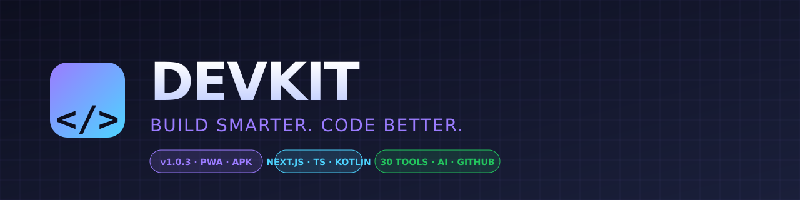
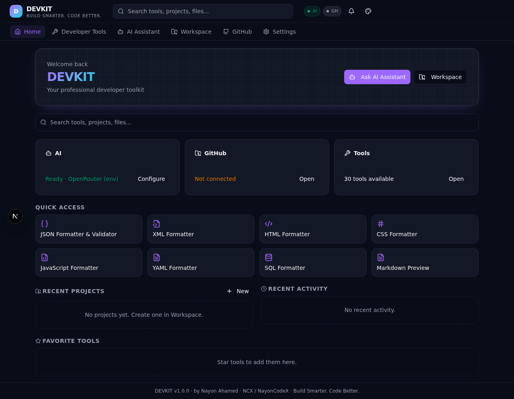
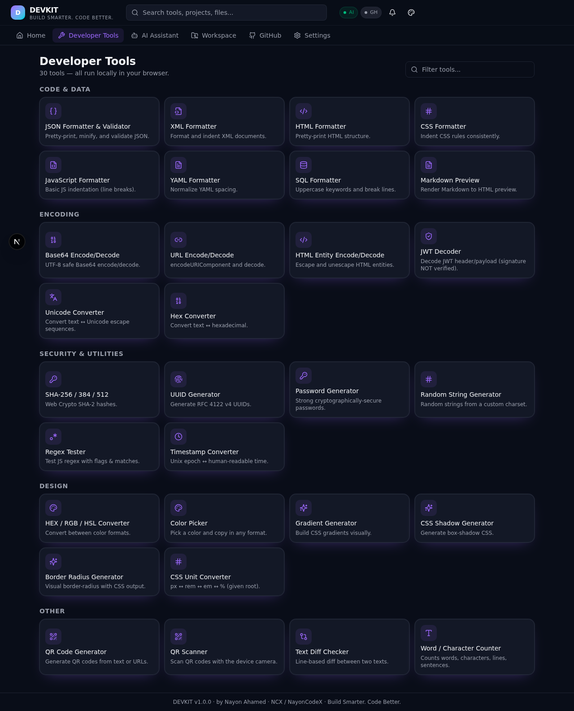
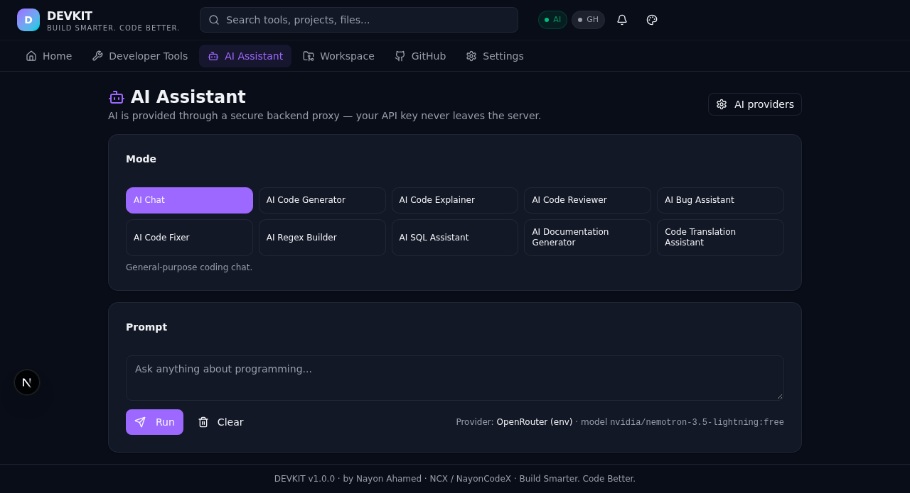
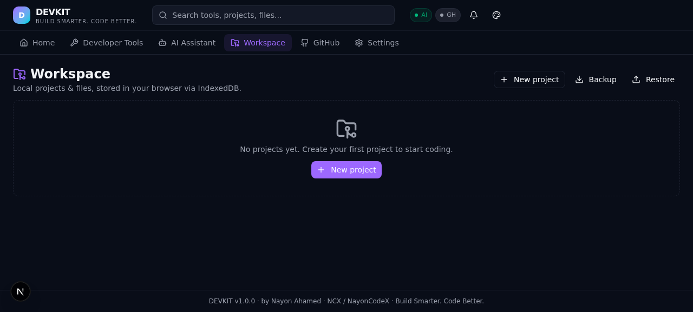
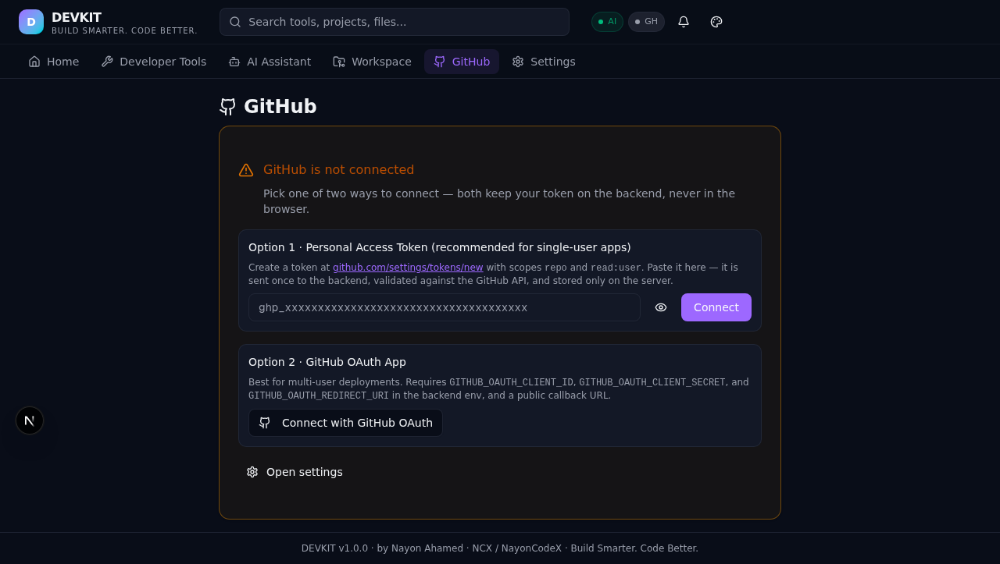
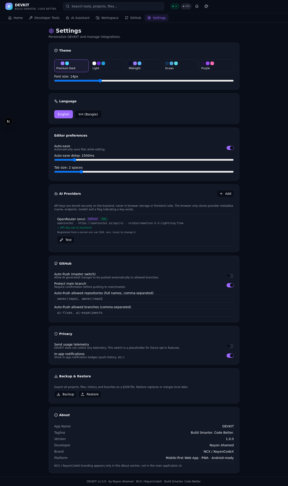

<div align="center">



<br/>

# DEVKIT

### Build Smarter. Code Better.

A professional, mobile-first developer toolkit + AI coding workspace, built as a PWA-ready Next.js application.

<br/>


<br/>

**30 real developer tools · 10 AI modes · In-app GitHub push · IndexedDB workspace · 5 themes · Bangla + English**

<br/>

### 📲 Download the Android APK

[**DEVKIT-v1.0.0.apk**](https://github.com/NayonCodeX/DEVKIT/releases/download/v1.0.0/DEVKIT-v1.0.0.apk) — 5.89 MB · Native Kotlin WebView app · Install on any Android 7.0+ phone

SHA256: `65fcedcd758020d750e08f1b1dae84c11cf764097639da8b0b02202a5261cc0f`

After installing, allow "Install from unknown sources" for your browser/file manager in Android settings, then tap the downloaded APK to install.

<br/>

</div>

---

## ✨ What is DEVKIT?

DEVKIT is a single-page PWA that bundles the day-to-day tools a developer actually uses — JSON formatter, JWT decoder, SHA hashes, UUID, QR generator/scanner, regex tester, color tools, diff checker — plus a **real AI coding assistant** (10 modes), a **local-first code workspace** with version history, and **GitHub integration** that pushes commits straight from the app.

It is **not a static demo**: every tool produces real output, the AI calls a real backend proxy, and the GitHub flow uses real OAuth or PAT authentication.

<br/>

## 🖼️ Screenshots

<table>
  <tr>
    <td width="50%" align="center"><b>Home Dashboard</b></td>
    <td width="50%" align="center"><b>Developer Tools (30 tools)</b></td>
  </tr>
  <tr>
    <td width="50%" align="center"></td>
    <td width="50%" align="center"></td>
  </tr>
  <tr><td colspan="2">&nbsp;</td></tr>
  <tr>
    <td width="50%" align="center"><b>AI Assistant (10 modes)</b></td>
    <td width="50%" align="center"><b>Code Workspace (IndexedDB)</b></td>
  </tr>
  <tr>
    <td width="50%" align="center"></td>
    <td width="50%" align="center"></td>
  </tr>
  <tr><td colspan="2">&nbsp;</td></tr>
  <tr>
    <td width="50%" align="center"><b>GitHub (in-app push)</b></td>
    <td width="50%" align="center"><b>Settings (5 themes + Bangla)</b></td>
  </tr>
  <tr>
    <td width="50%" align="center"></td>
    <td width="50%" align="center"></td>
  </tr>
</table>

<br/>

## 🎨 Design System

DEVKIT ships with **5 built-in themes** (default: Premium Dark) and a custom theme slot for future expansion. Each theme uses a navy background with purple → cyan accent gradient for a premium feel.

| Theme | Background | Primary | Accent |
|-------|-----------|---------|--------|
| **Premium Dark** (default) | `#1a1f3a` navy | `#9b7cff` purple | `#4dd4ff` cyan |
| **Light** | `#fafafa` | `#6c2bd9` | `#1e9bd6` |
| **Midnight** | `#0a0e2a` deep | `#a07cff` | `#56b8ff` |
| **Ocean** | `#133355` | `#4da3d9` | `#56d9e6` |
| **Purple** | `#22103f` | `#9a4dff` | `#ff6db3` |

Theme switching is instant (via `data-theme` attribute), persists in localStorage, and avoids flash-of-unstyled-content via a pre-paint inline script.

<br/>

## 🛠️ Developer Tools (30 tools, all real, all offline)

<details open>
<summary><b>Code &amp; Data (8)</b></summary>

- **JSON Formatter & Validator** — pretty-print, minify, validate with line:col error reporting
- **XML Formatter** — pretty-print XML
- **HTML Formatter** — basic indentation
- **CSS Formatter** — indent CSS rules consistently
- **JavaScript Formatter** — line-break after statements
- **YAML Formatter** — normalize spacing
- **SQL Formatter** — uppercase keywords + break clauses
- **Markdown Preview** — render small Markdown subset to HTML
</details>

<details open>
<summary><b>Encoding (6)</b></summary>

- **Base64 Encode/Decode** — UTF-8 safe
- **URL Encode/Decode** — encodeURIComponent / decodeURIComponent
- **HTML Entity Encode/Decode** — escape `<`, `>`, `&`, `"`, `'`
- **JWT Decoder** — decodes header & payload (signature **NOT verified** — tool states this)
- **Unicode Converter** — text ↔ `\uXXXX` escapes
- **Hex Converter** — text ↔ hex bytes (UTF-8)
</details>

<details open>
<summary><b>Security &amp; Utilities (6)</b></summary>

- **SHA-256 / 384 / 512** — Web Crypto SubtleCrypto
- **UUID Generator** — RFC 4122 v4 via `crypto.randomUUID()`
- **Password Generator** — cryptographically-secure, with strength meter
- **Random String Generator** — custom charset
- **Regex Tester** — live matches with groups + highlight
- **Timestamp Converter** — Unix ↔ ISO ↔ local, both directions
</details>

<details open>
<summary><b>Design (6)</b></summary>

- **HEX / RGB / HSL Converter** — bidirectional
- **Color Picker** — native color picker with HEX/RGB copy
- **Gradient Generator** — linear/radial CSS gradient
- **CSS Shadow Generator** — visual box-shadow
- **Border Radius Generator** — per-corner visual control
- **CSS Unit Converter** — px ↔ rem ↔ em ↔ %
</details>

<details open>
<summary><b>Other (4)</b></summary>

- **QR Code Generator** — real `qrcode` library, PNG download
- **QR Scanner** — real `jsqr` + camera (HTTPS required)
- **Text Diff Checker** — line-based LCS with +/− counts
- **Word / Character Counter** — live counts (words, chars, lines, sentences, paragraphs, reading time)
</details>

<br/>

## 🤖 AI Assistant (10 modes, secure backend proxy)

The AI section supports **10 specialized modes**:

| Mode | What it does |
|------|--------------|
| **AI Chat** | General-purpose coding chat |
| **AI Code Generator** | Generate code from a description |
| **AI Code Explainer** | Explain what provided code does |
| **AI Code Reviewer** | Review code for bugs, style, security |
| **AI Bug Assistant** | Diagnose a bug from code + error |
| **AI Code Fixer** | Suggest corrected code (with summary) |
| **AI Regex Builder** | Generate a regex from a description |
| **AI SQL Assistant** | Generate or explain SQL |
| **AI Documentation Generator** | Generate README / JSDoc |
| **Code Translation Assistant** | Translate code between languages |

### Supported providers

| Provider | Env var | Free tier? |
|----------|---------|-----------|
| **OpenRouter** (recommended) | `OPENROUTER_API_KEY` | ✅ yes — 5 free models pre-listed |
| OpenAI | `OPENAI_API_KEY` | no |
| Google Gemini | `GEMINI_API_KEY` | yes |
| Anthropic | `ANTHROPIC_API_KEY` | no |
| Custom (OpenAI-compatible) | none — set in Settings | depends |

**Pre-listed free OpenRouter models** (click to select in Settings → Add Provider):
- `nvidia/nemotron-3.5-lightning:free` (default)
- `cohere/north-mini-code:free`
- `google/gemma-4-26b-a4b-it:free`
- `google/gemma-4-31b-it:free`
- `nvidia/nemotron-3-ultra-550b-a55b:free`

### Security model

- API keys are stored **only on the backend** (server-side, never in browser localStorage/IndexedDB)
- The browser stores only provider metadata (name, endpoint, model) + a `hasKey` boolean
- AI calls go through `/api/ai/proxy` — the browser never sees the API key after it's set
- Setting `OPENROUTER_API_KEY` (or any other provider env var) auto-registers a default provider on the backend

<br/>

## 💻 Code Workspace & Project Manager

- Create / open / delete projects (IndexedDB)
- Create / rename / delete files and folders
- Touch-friendly code editor with tab-to-indent and `Ctrl/Cmd+S` to save
- **Auto-save** with configurable delay (500–10000ms)
- Find / Replace
- **File version history** — every save creates a snapshot, restore with one click
- **Project import / export** as JSON
- **Full backup / restore** of all IndexedDB data

<br/>

## 🐙 GitHub Integration (in-app push)

Two ways to connect — both keep tokens on the backend, never in the browser:

| | **Option 1: PAT** | **Option 2: OAuth** |
|---|---|---|
| Setup | Paste a token (no env needed) | Set 3 env vars + public callback URL |
| Best for | Single-user / solo dev | Multi-user deployments |
| Token storage | HTTP-only session cookie on backend | same |
| Scopes needed | `repo` + `read:user` | requested by OAuth App |

**Verified flow:**
1. User connects (PAT or OAuth)
2. App lists authorized repositories
3. User selects a repository + branch
4. User fetches a file → edits it → writes a commit message
5. App pushes via `/api/github/commit` and shows the resulting commit URL
6. Every push is recorded in the in-app notification system

**Auto Push** is opt-in and gated:
- Master switch (emergency OFF)
- Allowed-repo list + allowed-branch list
- "Protect main" confirmation gate
- Every push recorded in activity history

<br/>

## ⚙️ Personalization

- **5 themes** + custom theme slot (see Design System above)
- **2 languages**: English + বাংলা (Bangla)
- Font size slider (12–20px)
- Editor preferences (auto-save, tab size)
- AI + GitHub settings
- Privacy controls
- Backup & restore
- About (DEVKIT, v1.0.0, Build Smarter. Code Better., Nayon Ahamed, NCX / NayonCodeX)

<br/>

## 📱 PWA & APK

### PWA (works today)
- Web App Manifest at `/devkit/manifest.json`
- Service worker at `/devkit-sw.js` (stale-while-revalidate for shell, network-first for navigation, **never** caches `/api/*` or credentials)
- Installable on Android, iOS, and desktop
- Offline app shell works after first load

### APK (TWA via Bubblewrap — ready to ship)

DEVKIT is structured to be packaged as a Trusted Web Activity (TWA) for the Play Store. Once you deploy the app to a public HTTPS URL:

```bash
# Install Bubblewrap once
npm i -g @bubblewrap/cli

# Initialize from the deployed manifest
bubblewrap init --manifest https://your-deployment.example.com/devkit/manifest.json

# Build the APK / AAB
bubblewrap build
```

The output `app-release-signed.apk` can be uploaded to the Play Store. The TWA approach means the entire app is still served from your HTTPS URL — no separate native build to maintain.

See [`docs/APK_BUILD.md`](docs/APK_BUILD.md) for the complete step-by-step guide.

<br/>

## 🚀 Quick start (local development)

```bash
# 1. Clone the repo
git clone https://github.com/NayonCodeX/DEVKIT.git
cd DEVKIT

# 2. Install dependencies
bun install   # or: npm install

# 3. Configure env (optional — only needed for AI / GitHub)
cp .env.example .env.local
# Edit .env.local — simplest path: paste a free OpenRouter key from
# https://openrouter.ai/keys into OPENROUTER_API_KEY=

# 4. Run the dev server
bun run dev
# Open http://localhost:3000
```

That's it. The OpenRouter key auto-registers an AI provider on the backend — the AI Assistant section is ready immediately. All 30 developer tools work offline with no configuration.

<br/>

## 🔐 Security

DEVKIT was designed with a real security model, not a demo one. Highlights:

- **No secrets in the repo** — `.env`, `.env.local`, and any key file are gitignored
- **No secrets in the browser** — API keys and GitHub tokens are stored only on the backend
- **Backend proxy for AI** — the browser sends `providerId + prompt`, the backend adds the key and forwards
- **HTTP-only session cookie** for GitHub auth (PAT and OAuth both)
- **Service worker never caches `/api/*`** — no credentials in cache
- **JWT Decoder explicitly warns** that the signature is **not verified**
- **Auto Push is opt-in** with allowed-repo + allowed-branch lists + emergency OFF switch
- **File deletion always requires confirmation**; version restore asks for confirmation and auto-saves the current state first

See [`docs/SECURITY.md`](docs/SECURITY.md) for the full model.

<br/>

## 📦 Tech stack

| Layer | Tech |
|-------|------|
| Framework | Next.js 16 (App Router) · React 19 |
| Language | TypeScript 5 |
| Styling | Tailwind CSS 4 · shadcn/ui · Lucide icons |
| State | Zustand (client) · IndexedDB (persistence) |
| Backend | Next.js API routes (Node runtime) — same deployment |
| Crypto | Web Crypto (SubtleCrypto) · `crypto.randomUUID()` |
| QR | `qrcode` (generation) · `jsqr` (scanning) |
| PWA | Web App Manifest + custom service worker |

<br/>

## 📁 Project structure

```
DEVKIT/
├── public/
│   ├── devkit/                    # PWA icons + manifest
│   └── devkit-sw.js                # service worker
├── src/
│   ├── app/
│   │   ├── layout.tsx · page.tsx   # main shell + navigation
│   │   ├── globals.css            # themes + design system
│   │   └── api/
│   │       ├── ai/proxy/          # secure AI proxy
│   │       ├── ai/test/           # provider connection test
│   │       ├── ai/providers/      # list/keys/meta endpoints
│   │       ├── github/oauth/      # start/callback/revoke
│   │       ├── github/connect-pat/ # PAT-based connect
│   │       ├── github/session/repos/branches/file/commit/
│   │       └── health/
│   ├── components/
│   │   ├── ui/                    # shadcn/ui (pre-existing)
│   │   └── devkit/
│   │       ├── sections/          # home, tools, ai, workspace, github, settings
│   │       └── tools/             # 30 tool components + registry
│   └── lib/
│       └── devkit/
│           ├── types.ts           # shared types
│           ├── db.ts              # IndexedDB layer
│           ├── store.ts           # Zustand (localStorage for prefs only)
│           ├── i18n.ts            # Bangla + English
│           ├── utils.ts           # formatters, crypto, color, diff
│           ├── ai-client.ts       # browser-side AI helpers
│           ├── server-store.ts    # server-side key store
│           └── github-pat-store.ts # PAT session store
├── docs/
│   ├── SECURITY.md                # full security model
│   ├── TESTING.md                 # manual test checklist
│   ├── GITHUB_UPLOAD.md           # step-by-step publish guide
│   ├── APK_BUILD.md                # Bubblewrap TWA guide
│   └── screenshots/               # README screenshots
├── scripts/
│   ├── gen-icons.js               # PWA icon generator
│   └── gen-hero.js                # README hero banner generator
├── .env.example                   # template (no secrets)
├── README.md · LICENSE · package.json · bun.lock
```

<br/>

## 🚢 Deployment

The Next.js app (frontend + backend routes) deploys as a single unit to any Node-compatible host. **GitHub Pages cannot run a Node.js backend** — use Vercel, Netlify (with functions), Render, Railway, or Fly.io instead.

```bash
bun run build
bun run start
```

Don't forget to set the env vars (`OPENROUTER_API_KEY`, `APP_PUBLIC_URL`, etc.) on your hosting provider's dashboard.

<br/>

## 🧪 Testing

A manual test checklist is in [`docs/TESTING.md`](docs/TESTING.md) — covers every tool, every navigation item, theme switching, language switching, IndexedDB persistence, AI configuration errors, GitHub authentication, commit/push, offline, mobile, desktop.

A scripted test for all 10 AI modes is in [`scripts/test-ai-modes.sh`](scripts/test-ai-modes.sh) — runs real calls against the configured AI provider and verifies each mode returns a response.

<br/>

## ⚠️ Known limitations

- Backend key/session stores are in-memory (good for demo + small deployments; production should use a real secret manager)
- The JS / CSS / HTML / XML / YAML formatters are intentionally lightweight (no full AST) — pipe through prettier locally for production-grade formatting
- Monaco Editor intentionally omitted to keep the bundle small for low-powered Android (touch-friendly textarea editor used instead)
- Some free OpenRouter reasoning models (e.g. `nemotron-3.5-lightning:free`) sometimes return empty visible responses when the entire token budget is consumed by reasoning — DEVKIT shows a clear hint in that case and the default `max_tokens` is set to 2500 to minimize this
- QR Scanner requires HTTPS + camera permission; on desktop without a camera, it shows a clear error rather than faking a scan

<br/>

## 📜 Credits

| | |
|---|---|
| **App name** | DEVKIT |
| **Tagline** | Build Smarter. Code Better. |
| **Version** | 1.0.0 |
| **Developer** | Nayon Ahamed |
| **Brand** | NCX / NayonCodeX |
| **License** | MIT |

NCX / NayonCodeX branding appears only in the About section and the footer — not in the main application UI.

<br/>

## 📄 License

MIT © 2026 Nayon Ahmed (NCX / NayonCodeX). See [LICENSE](LICENSE).

<br/>

<div align="center">

<sub>Built with ❤️ by <b>Nayon Ahamed</b> · <a href="https://github.com/NayonCodeX">NCX / NayonCodeX</a></sub>

<sub>If DEVKIT helps you, please ⭐ the repo — it helps others find it.</sub>

</div>
